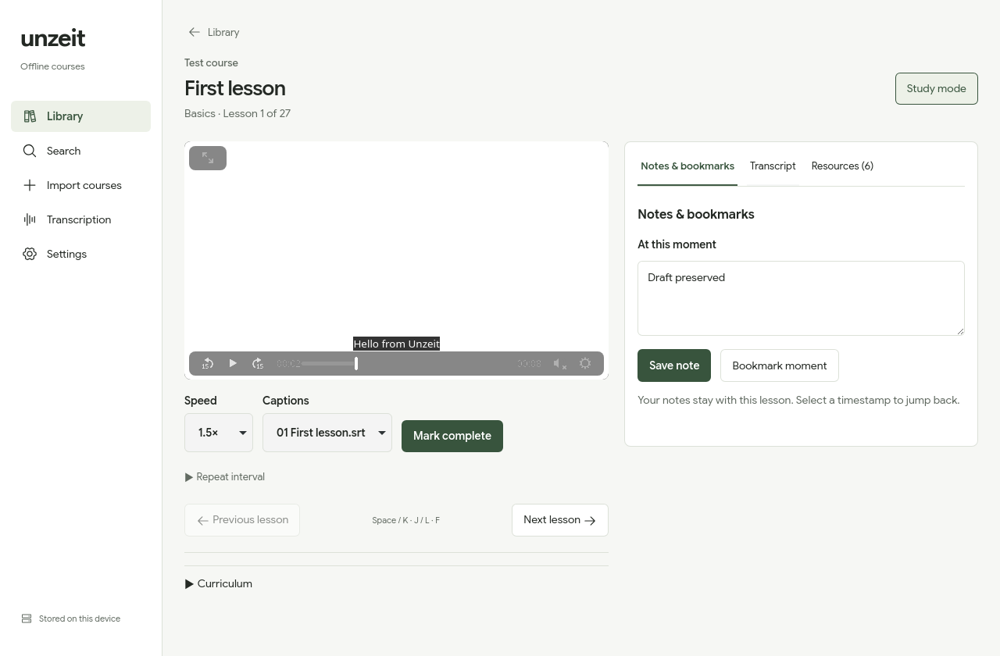

# Unzeit

**Biblioteca de cursos offline para Linux.**

O Unzeit organiza os cursos que você já baixou. Assista às aulas, retome de onde
parou e encontre anotações e trechos de legendas sem sair do aplicativo. Os
vídeos ficam nas suas pastas, e o progresso e as anotações ficam no computador.

**[Baixar para Linux](https://github.com/meursault03/unzeit/releases/latest)** · [Guia completo](README.pt.md) · [English](README.en.md)



*Modo de estudo com um curso de demonstração. A interface também está disponível em português.*

## O que você pode fazer

- **Organizar sua biblioteca.** Importe pastas com aulas em MP4 e mantenha os
  PDFs, imagens, textos e arquivos de código ligados ao curso.
- **Retomar e revisar aulas.** Volte ao ponto em que parou, salve anotações e
  marcadores com horário e repita um trecho com os controles A–B.
- **Buscar o que estudou.** Encontre cursos, aulas, anotações e falas nas
  legendas. Clique em um trecho da transcrição para ir ao momento no vídeo.
- **Gerar legendas no computador.** Use o Whisper para transcrever uma aula ou
  colocar as aulas restantes de um curso na fila.
- **Acompanhar sua rotina.** Consulte o tempo de estudo da semana, defina uma
  meta em minutos e marque as aulas concluídas.

## Instalar no Linux

O projeto está em desenvolvimento e foi verificado em **Linux x86_64**. A
[página de versões](https://github.com/meursault03/unzeit/releases/latest)
reúne os instaladores e o arquivo `SHA256SUMS`.

| Formato | Como instalar ou abrir |
| --- | --- |
| **AppImage** | Nas propriedades do arquivo, permita a execução e abra-o. Também pode usar o terminal, como no exemplo abaixo. |
| **Arch Linux** | `sudo pacman -U ./unzeit-0.4.3-1-x86_64.pkg.tar.zst` |
| **Fedora** | `sudo dnf install ./Unzeit-0.4.3-1.x86_64.rpm` |
| **Flatpak** | `flatpak install --user ./unzeit-0.4.3-x86_64.flatpak` |

Na pasta em que baixou o AppImage:

```sh
chmod +x ./Unzeit_0.4.3_amd64.AppImage
./Unzeit_0.4.3_amd64.AppImage
```

Use o nome do arquivo que você baixou. Para reproduzir vídeos no AppImage,
você precisa dos codecs GStreamer adequados. O seletor de pastas também
depende dos portais do desktop. Os pacotes Fedora e Flatpak são experimentais.
Veja os [requisitos e problemas comuns](README.pt.md#problemas-comuns) se
precisar de ajuda. Windows e macOS ainda não foram verificados.

## Importar seu primeiro curso

1. Extraia o curso se estiver em ZIP, RAR ou outro arquivo compactado.
2. Abra **Importar cursos** e selecione a pasta que reúne seus cursos.
3. Clique em **Buscar cursos**, confira a prévia e confirme em **Importar**.
4. Abra o curso na biblioteca e escolha uma aula. Use **Marcar como concluída**
   para registrar que terminou.

Por exemplo, selecione `Cursos/` como raiz para importar esta estrutura:

```text
Cursos/
└── Rust básico/
    └── 01 Introdução/
        ├── 01 Boas-vindas.mp4
        ├── 01 Boas-vindas.pt.srt
        └── Slides.pdf
```

Também é possível importar cursos sem subpastas de seção. O Unzeit reconhece
legendas SRT e VTT com o mesmo nome-base do vídeo e preserva a organização dos
arquivos. Veja [como importar pacotes e pastas aninhadas](README.pt.md#importar-seu-primeiro-curso).

## Transcrever aulas

Para gerar legendas, instale **FFmpeg e FFprobe** e importe, nas
**Configurações**, um
[modelo Whisper medium multilíngue em GGML](https://huggingface.co/ggerganov/whisper.cpp/tree/main),
como `ggml-medium-q5_0.bin`. Depois, abra uma aula e use **Gerar legendas**.

O processamento ocorre na CPU, uma aula por vez. Você pode continuar assistindo
enquanto a fila roda. Para reutilizar legendas que já vieram com o curso, basta
importar os arquivos SRT ou VTT junto dos vídeos.
[Instruções completas de transcrição](README.pt.md#gerar-legendas).

## Dados e backup

O Unzeit mantém progresso, anotações e preferências em um banco SQLite local.
Na instalação nativa e no AppImage, o diretório padrão é
`~/.local/share/local.unzeit.desktop/`. O Flatpak usa um diretório separado.
Feche o aplicativo antes de copiar os dados.
[Diretórios, atualizações e recuperação de arquivos](README.pt.md#idioma-dados-e-atualizações).

## Contribuir

O aplicativo usa **Tauri, Rust, React e SQLite**.
O [guia de contribuição](CONTRIBUTING.md#português) reúne os pré-requisitos
para compilar, testar e empacotar o projeto. Para relatar um problema, informe
a versão do app, a distribuição Linux, o ambiente gráfico e os passos
para reproduzir. [Abrir uma issue](https://github.com/meursault03/unzeit/issues).

## Licença

O Unzeit é distribuído sob a [licença MIT](LICENSE).
As atribuições de fontes e dependências estão no [guia completo](README.pt.md#licença).
