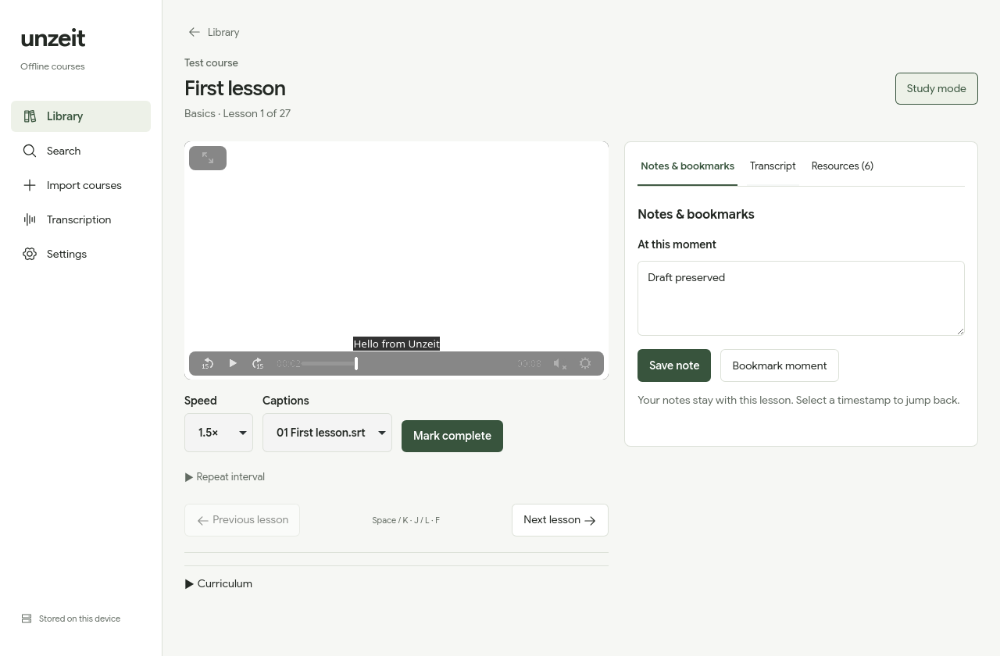

# Unzeit

Português · [English](README.en.md)

Uma biblioteca de cursos para estudar o conteúdo que você já baixou. Assista às
aulas, retome do ponto em que parou e mantenha anotações, legendas e materiais
junto de cada curso. Os vídeos permanecem nas suas pastas; os dados de estudo
ficam no computador.

[Instalação](#instalar-no-linux) · [Primeiro curso](#importar-seu-primeiro-curso) ·
[Estudo](#estudar-uma-aula) · [Rotina](#rotina-de-estudo) · [Legendas](#gerar-legendas) ·
[Problemas comuns](#problemas-comuns) · [Desenvolvimento](#desenvolvimento)



*Captura do aplicativo Linux com um curso de demonstração e interface em inglês.*

## Instalar no Linux

O Unzeit está em desenvolvimento, com verificação local em Linux x86_64.
Ainda não há instaladores publicados em [Releases](https://github.com/meursault03/unzeit/releases).
Você pode compilar o aplicativo seguindo [Desenvolvimento](#desenvolvimento),
ou usar as [receitas de pacotes](#pacotes-para-linux). Windows e macOS ainda não
foram verificados.

Se você já tem um AppImage gerado localmente, permita sua execução nas
propriedades do arquivo e abra-o. Pelo terminal, na pasta do arquivo:

```sh
chmod +x ./Unzeit_0.4.0_amd64.AppImage
./Unzeit_0.4.0_amd64.AppImage
```

Substitua o nome pelo arquivo que você tem. O AppImage ainda depende dos codecs
GStreamer e dos portais do seu desktop. FFmpeg e FFprobe são necessários para
gerar legendas; o modelo Whisper é importado separadamente.

Para um pacote local, use o gerenciador correspondente à sua instalação:

| Formato | Instalação |
| --- | --- |
| Arch `.pkg.tar.zst` | `sudo pacman -U /caminho/unzeit.pkg.tar.zst` |
| Fedora `.rpm` | `sudo dnf install /caminho/Unzeit.rpm` |
| Flatpak `.flatpak` | `flatpak install --user /caminho/Unzeit.flatpak` |

Substitua os caminhos pelo pacote recebido ou compilado. Se você tem o código
do repositório, `bash packaging/install.sh /caminho/do/pacote.rpm` escolhe o
gerenciador para os três formatos e mantém sua confirmação de instalação.
O script não baixa arquivos. As receitas Fedora e Flatpak ainda são experimentais;
veja o estado de verificação em [Pacotes para Linux](#pacotes-para-linux).
Na primeira instalação do Flatpak, pode ser necessário baixar o runtime do Flathub.

## Importar seu primeiro curso

1. Extraia o curso se ele estiver em ZIP, RAR ou outro arquivo compactado.
2. Abra **Importar cursos** e clique em **Escolher pasta** para selecionar a pasta
   que contém seus cursos. Você também pode colar o caminho em **Pasta da biblioteca**.
3. Clique em **Buscar cursos**. Confira as seções e aulas na prévia; desmarque
   os cursos que não quer adicionar.
4. Clique em **Importar**. Abra o curso na biblioteca para assistir à primeira aula.

Use **Cancelar** no seletor do sistema para sair sem escolher uma pasta, ou
**Voltar à biblioteca** para sair da importação. Buscar arquivos apenas prepara
a prévia; a importação acontece na confirmação.

Uma organização de pastas que funciona:

```text
Cursos/
  Rust básico/
    01 Introdução/
      01 Boas-vindas.mp4
      01 Boas-vindas.pt.srt
      Slides.pdf
    02 Exercícios/
      01 Primeiro programa.mp4
      solução.rs
      leitura.html
```

Nesse exemplo, escolha `Cursos` como raiz. Cursos com vídeos diretamente na
pasta e cursos com seções aninhadas também funcionam. Apenas MP4 é indexado;
a numeração pode reiniciar em cada seção. A ordenação é natural, e os arquivos
não são renomeados nem movidos. Links simbólicos são ignorados.

Se o download contém uma pasta intermediária, use **Escolher pasta interna**.
Em pacotes com vários cursos, desmarque a pasta do pacote e use **Adicionar
curso individual** para cada curso. A prévia mostra avisos quando uma legenda
não pode ser associada com segurança à aula.

## Estudar uma aula

O player salva a posição de reprodução. Para terminar uma aula, clique em
**Marcar como concluída**; assistir ao fim não marca a conclusão automaticamente.
Na biblioteca, **Continuar** abre sua aula recente.

- **Anotações e marcadores:** escreva e salve uma anotação, ou use **Marcar momento**.
  Clique no horário salvo para voltar ao trecho. Excluir pede confirmação.
- **Modo de estudo:** coloca anotações, transcrição ou materiais ao lado do vídeo.
  No modo normal, ficam abaixo; a lista de aulas tem rolagem própria.
- **Transcrição:** busque uma frase na legenda e clique no trecho para ouvi-lo.
  A busca geral também encontra títulos de cursos, aulas, anotações e falas.
- **Repetir trecho:** expanda o controle, marque A e B e ative a repetição.
  O indicador continua visível quando os controles são recolhidos.

### Materiais de apoio

Em **Materiais**, selecione o arquivo que quer estudar. Arquivos da aula e do
curso aparecem nessa lista.

| Material | Como usar |
| --- | --- |
| PDF | Leia e navegue pelas páginas dentro do app. |
| Imagem | Abra a prévia dentro do app. Imagens acima de 16 MiB usam o aplicativo externo. |
| Texto e código UTF-8 | Busque no arquivo, selecione linhas e copie o trecho. A prévia suporta até 1 MiB e nunca executa código. |
| HTML/HTM | Abre automaticamente no navegador padrão. O botão **Abrir no navegador** permite tentar novamente. |
| SVG, executáveis e formatos sem prévia | Use **Mostrar na pasta** ou a ação externa indicada no botão. |

Para selecionar um trecho de código, clique no número da primeira linha e
use Shift + clique na última. Você também pode informar os números de linha
e usar **Copiar linhas selecionadas**.

### Atalhos do player

| Tecla | Ação |
| --- | --- |
| Espaço ou K | Reproduzir ou pausar |
| J / L ou setas esquerda / direita | Voltar ou avançar 10 segundos |
| F | Tela cheia |

Os atalhos não interceptam a digitação nos campos de texto.

## Rotina de estudo

Na biblioteca, expanda **Tempo de estudo nesta semana** para ver os minutos
estudados de segunda a domingo. Para definir uma meta, preencha **Meta semanal
(minutos)** e clique em **Salvar meta**. A meta é opcional; use `0` para desativá-la.

A contagem usa o tempo real de reprodução, mesmo com velocidade aumentada.
Pausas, espera pelo vídeo, saltos e suspensão do computador ficam fora do total.
Esse histórico começa a ser registrado na versão 0.4; o progresso anterior não
é convertido em horas estimadas. A conclusão das aulas continua separada da meta.

## Gerar legendas

Legendas existentes não exigem Whisper. Coloque o SRT/VTT com o mesmo nome-base
do vídeo: `01 Boas-vindas.mp4` e `01 Boas-vindas.pt.srt`, por exemplo. As pastas
`Subs` e `Subtitles` também são reconhecidas. Depois de adicionar arquivos a um
curso importado, use **Verificar arquivos do curso**.

Para transcrever uma aula sem legenda:

1. Baixe um modelo **medium multilíngue GGML** da
   [coleção oficial do whisper.cpp](https://huggingface.co/ggerganov/whisper.cpp/tree/main),
   como `ggml-medium.bin` ou `ggml-medium-q5_0.bin`. Modelos `.en` não são aceitos.
2. Em **Configurações**, clique em **Importar modelo medium** e escolha o `.bin`.
   O modelo é validado e copiado para a pasta de dados do Unzeit. O completo
   ocupa cerca de 1,5 GB; as versões quantizadas ocupam menos.
3. Abra a aula e clique em **Gerar legendas**. Para o curso inteiro, use
   **Legendar aulas restantes** na lista de aulas.
4. Acompanhe o progresso em **Transcrição**. É possível assistir enquanto a fila roda.

A transcrição acontece na CPU, uma aula por vez. Dependendo do processador,
gerar legendas pode levar mais tempo que a duração da aula. **Cancelar** solicita a parada,
inclusive durante o carregamento do modelo. O status muda para cancelado depois
que o processo termina.
SRT e VTT são escritos ao lado do vídeo, com alternativa na pasta de dados se
a pasta do curso for somente leitura. Vídeos e legendas existentes não são
sobrescritos. O conteúdo não é traduzido e o vídeo não é regravado.

### Levar a legenda para outro player

Use o SRT ao lado do vídeo ou crie uma cópia MP4 com uma faixa de legenda
selecionável. Esse passo é feito no terminal, com [FFmpeg](https://ffmpeg.org/ffmpeg.html):

```sh
ffmpeg -n -i 'aula.mp4' -i 'aula.generated.srt' \
  -map 0 -map 1:0 -c copy -c:s mov_text 'aula.legendada.mp4'
```

Substitua os nomes pelos seus arquivos. `-n` impede sobrescrever a saída; áudio
e vídeo são copiados sem recodificação. A legenda pode ser ligada e desligada
no player; ela não fica gravada na imagem do vídeo.

## Idioma, dados e atualizações

Na primeira abertura, o app usa o primeiro idioma compatível do sistema:
português, inglês ou espanhol; inglês é a alternativa. Você pode mudar em
**Configurações → Idioma do aplicativo**. Essa escolha é salva e não traduz
as aulas. Os temas claro, escuro e do sistema também ficam em Configurações.

Progresso, conclusão, anotações e preferências ficam na pasta de dados.
Feche o app antes de copiá-la para um backup:

| Instalação | Pasta padrão no Linux |
| --- | --- |
| Nativa / AppImage | `~/.local/share/local.unzeit.desktop/` |
| Flatpak | `~/.var/app/local.unzeit.desktop/data/local.unzeit.desktop/` |

Esses caminhos podem mudar com as variáveis XDG do sistema. O Flatpak mantém
dados separados: importe sua biblioteca e seu modelo nele. Versões antigas
podem não abrir um banco atualizado; faça backup antes de atualizar.

Verificar os arquivos preserva progresso e anotações. Se você mover o curso
ou renomear uma aula, use **Atualizar caminho da pasta** ou **Atualizar caminho
da aula** antes de verificar novamente. Apenas uma instância pode usar a mesma
pasta de dados.

## Problemas comuns

| Problema | O que conferir |
| --- | --- |
| O app abre, mas o vídeo não toca | Os codecs GStreamer da distro precisam reconhecer o vídeo. FFmpeg sozinho não fornece os codecs do player. |
| O seletor de pastas não abre | Instale `xdg-desktop-portal` e o backend do seu desktop: `-kde`, `-gnome` ou `-gtk`. |
| O AppImage reclama de FUSE | Use `APPIMAGE_EXTRACT_AND_RUN=1 ./Unzeit_0.4.0_amd64.AppImage`, com o nome do seu arquivo. [Guia AppImage](https://docs.appimage.org/user-guide/run-appimages.html). |
| Nenhum curso aparece | Confira a raiz, extraia os arquivos compactados e confirme que há MP4 dentro das pastas. |
| O vídeo aparece como ausente | Atualize o caminho da pasta ou da aula; depois verifique os arquivos do curso. |
| A transcrição não começa | Confira FFmpeg/FFprobe em Configurações e importe um modelo medium multilíngue. |
| HTML não abriu | Use **Abrir no navegador** e confira seu navegador padrão. Se ele não estiver registrado, a associação HTML do sistema é usada. |

Para reportar um problema, abra uma [issue](https://github.com/meursault03/unzeit/issues)
com a versão do app, distro, desktop, instalação usada e passos para reproduzir.
Um trecho do erro ajuda; não é necessário anexar seu curso.

## Desenvolvimento

Requer Node.js 22.12+, Rust 1.90+, CMake, Clang/libclang, GTK 3 e WebKitGTK 4.1.
Veja os [pré-requisitos oficiais do Tauri para Linux](https://v2.tauri.app/start/prerequisites/#linux).
Instale também FFmpeg/FFprobe e os codecs GStreamer dos seus vídeos.

```sh
git clone https://github.com/meursault03/unzeit.git
cd unzeit
npm ci
npm run tauri dev
```

`npm run dev` abre apenas a prévia no navegador; arquivos locais exigem o app
desktop. Para gerar um AppImage, execute `npm run tauri build`. O resultado fica
em `src-tauri/target/release/bundle/appimage/`.

### Pacotes para Linux

As receitas em `packaging/` usam Python 3.11+ e a versão dos metadados do projeto.
Execute na raiz do repositório. Os resultados ficam em `artifacts/`; para repetir
a preparação, use `--output` com uma pasta nova. Cursos, modelos e bancos não
entram no pacote. Nenhum pacote foi publicado no AUR ou no Flathub.

<details>
<summary>Arch: gerar e instalar o pacote local</summary>

```sh
python3 packaging/prepare.py arch
cd artifacts/arch
makepkg -si
```

O pacote 0.4.0 foi compilado e instalado em uma raiz Arch isolada; a verificação
de integridade e de bibliotecas passou. A receita declara as dependências de mídia;
instale também o backend do portal para seu desktop. Não há entrada no AUR.

</details>

<details>
<summary>Fedora: gerar o RPM com Podman</summary>

```sh
python3 packaging/prepare.py fedora
podman build -t unzeit-rpm -f artifacts/fedora/Containerfile artifacts/fedora/source
mkdir -p artifacts/rpm
podman run --rm -v "$PWD/artifacts/rpm:/out:Z" unzeit-rpm
sudo dnf install artifacts/rpm/*.rpm
```

A receita usa Fedora 43. Compile no Fedora para manter a compatibilidade de
bibliotecas. O RPM 0.4.0 foi compilado e instalado em um ambiente Fedora 43
isolado, com integridade, bibliotecas, reprodução H.264/AAC e extração WAV
mono a 16 kHz verificadas. A interface e o seletor em uma sessão Fedora
ainda precisam de teste.
O [FFmpeg livre do Fedora](https://packages.fedoraproject.org/pkgs/ffmpeg/ffmpeg-free/)
suporta menos codecs; confira reprodução e extração com seus arquivos.

</details>

<details>
<summary>Flatpak: compilar a receita local</summary>

Instale `flatpak-builder` e os runtimes abaixo. A preparação baixa dependências
fixadas para o build sem rede dentro do SDK; use `--offline` se já estiverem no cache.

```sh
flatpak remote-add --user --if-not-exists flathub https://dl.flathub.org/repo/flathub.flatpakrepo
flatpak install --user flathub org.gnome.Platform//50 org.gnome.Sdk//50 \
  org.freedesktop.Sdk.Extension.node22//25.08 \
  org.freedesktop.Sdk.Extension.rust-stable//25.08 \
  org.freedesktop.Sdk.Extension.llvm21//25.08
python3 packaging/prepare.py flatpak
flatpak-builder --user --install --force-clean --state-dir=artifacts/flatpak-state \
  artifacts/flatpak-build artifacts/flatpak/local.unzeit.desktop.json
flatpak run local.unzeit.desktop
```

O build 0.4.0 foi compilado no SDK e instalado em um ambiente isolado. Importação
de pastas autorizadas pelo portal, reprodução H.264/AAC, avanço, velocidade,
legendas WebVTT e salvamento ao fechar passaram nos testes. O pacote usa
codecs/FFmpeg do runtime e dados separados da instalação nativa, sem acesso geral
à pasta pessoal. A interação manual com o seletor no seu desktop ainda precisa
ser conferida.

</details>

### Verificações

```sh
npm run check
npm test
npm run build
cargo test --manifest-path src-tauri/Cargo.toml --no-default-features --lib
cargo clippy --manifest-path src-tauri/Cargo.toml --all-targets -- -D warnings
cargo fmt --manifest-path src-tauri/Cargo.toml -- --check
```

`bash tests/webview-smoke.sh` verifica o WebKit nativo com mídia gerada e dados
isolados. Guarda relatórios e imagens em uma pasta temporária. Compile normalmente
depois; a feature `webview-smoke` é exclusiva de teste.

Use `UNZEIT_TEST_CLOSE_ONLY=1` para verificar fechamento e posição final,
`UNZEIT_TEST_PLAYING_CLOSE=1` para fechar durante reprodução, ou
`UNZEIT_TEST_UX_ONLY=1` para os fluxos de erro e recuperação. O seletor real exige
Python GI/AT-SPI e um portal acessível; `UNZEIT_TEST_PICKER_MOCK=1` verifica o
estado do app com IPC controlado quando o portal Wayland não é acessível.

Para verificar a inferência real, forneça o modelo medium e o
[áudio JFK oficial](https://github.com/ggml-org/whisper.cpp/blob/master/samples/jfk.wav):

```sh
cargo build --manifest-path src-tauri/Cargo.toml --bin unzeit
UNZEIT_TEST_MODEL=/caminho/ggml-medium-q5_0.bin \
UNZEIT_TEST_AUDIO=/caminho/jfk.wav \
UNZEIT_TEST_EXECUTABLE="$PWD/src-tauri/target/debug/unzeit" \
cargo test --manifest-path src-tauri/Cargo.toml --no-default-features --lib \
  real_medium_transcription -- --ignored
```

## Licença

MIT. Google Sans Flex é distribuída sob SIL OFL 1.1, com licença e marcas
preservadas em `public/fonts/`. PDF.js usa Apache-2.0; os arquivos de suporte e
estilos mantêm a atribuição original.
